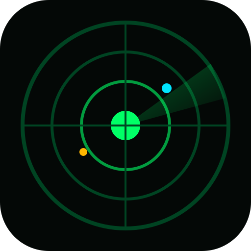

# 📡 MC.GYVER RF // Tactical Wi-Fi Radar & Dual-Band Sensing System



> **Kompletný systém pasívneho rádiového prieskumu, detekcie dronov (ASTM F3411, DJI DroneID), Wi-Fi sensingu (detekcia pohybu osôb cez Fresnelove zóny) a mobilný PWA radar na celých 100dvh.**

---

## 📑 Obsah
1. [Prehľad a Architektúra](#-prehľad-a-architektúra)
2. [Hardvérová špecifikácia](#-hardvérová-špecifikácia)
3. [Využité technológie a vedecký základ](#-využité-technológie-a-vedecký-základ)
4. [Popis modulov a skriptov](#-popis-modulov-a-skriptov)
5. [Inštalácia a prerekvizity](#-inštalácia-a-prerekvizity)
6. [Návod na použitie](#-návod-na-použitie)
7. [PWA a Mobilný prístup (iPhone / Android / Desktop)](#-pwa-a-mobilný-prístup)
8. [Forenzné poznatky a riešenie problémov](#-forenzné-poznatky-a-riešenie-problémov)
9. [Bezpečnostné a právne aspekty](#-bezpečnostné-a-právne-aspekty)

---

## 🔭 Prehľad a Architektúra

Systém vznikol z potreby vytvoriť taktický rádiový prehľad o okolí s bežne dostupným hardvérom za nízke náklady:
* **Prijímač 2.4 GHz:** USB adaptér D-Link DWA-137 s vymeniteľnou anténou cez RP-SMA konektor (čip Realtek RTL8192EU v Monitor Mode).
* **Vysielač / Referencia 5 GHz:** Domáci Wi-Fi router vysielajúci na kanáli 36 (5180 MHz) so šírkou pásma 80 MHz.
* **Spracovanie:** Linuxový engine v Pythone s využitím `tshark`, `scapy` a nízkoúrovňových 802.11 Radiotap hlavičiek.
* **Prezentácia dát:** Moderná PWA webová aplikácia s 360° PPI kruhovým radarom, smerovým navádzaním, 5 GHz interiérovým seizmografom a kopírovaním MAC adries jedným kliknutím.

```
+-----------------------------------------------------------------------------------+
|                                  RÁDIOVÝ ÉTER                                     |
|  2.4 GHz: Drony (ASTM F3411, DroneID), Telefóny (Probe Req), Cudzie AP            |
|  5.0 GHz: Domáci router TP-Link (Ch 36, 5180 MHz, 5.8 cm vlnová dĺžka)            |
+-----------------------------------------------------------------------------------+
             │                                                 │
             ▼                                                 ▼
+-------------------------+                       +-------------------------+
|   D-Link DWA-137 (USB)  |                       |   Interná Wi-Fi karta   |
|   Monitor Mode (Ch 1-13)|                       |   Managed Mode (5 GHz)  |
+-------------------------+                       +-------------------------+
             │                                                 │
             └───────────────────────┬─────────────────────────┘
                                     ▼
                    +-----------------------------------+
                    |    Linux Core Engine (Python 3)   |
                    |    - drone_radar_pro.py           |
                    |    - toggle_mode.py               |
                    |    - web_server.py (Port 9000)    |
                    +-----------------------------------+
                                     │
                     ┌───────────────┴───────────────┐
                     ▼                               ▼
       +---------------------------+   +---------------------------+
       |   Lokálny Desktop (Linux) |   |   Mobilný Klient (iPhone) |
       |   PWA / Web Panel 100dvh  |   |   Safari PWA: 192.168.7.5 |
       +---------------------------+   +---------------------------+
```

---

## 🛠️ Hardvérová špecifikácia

| Komponent | Model / Čip | Frekvencia | Režim | Úloha |
| :--- | :--- | :--- | :--- | :--- |
| **USB Dongle** | D-Link DWA-137 (Rev E1) | 2.4 GHz (802.11b/g/n) | Monitor Mode (`rtl8xxxu`) | Pasívne odchytávanie paketov, Remote ID, meranie RSSI do 250m+ |
| **Anténa** | ~5 dBi všesmerová (RP-SMA) | 2.4 GHz | Prútový dipól | Možnosť nasadenia parabolického reflektora Windsurfer (+10 dBi) |
| **Domáci Router** | TP-Link Systems | 2.4 GHz + 5 GHz | AP / Gateway | Referenčný vysielač pre Wi-Fi Sensing a Fresnelove zóny |
| **Klient / Prijímač 5G** | Interná karta (`wlp3s0`) | 5 GHz (802.11ac/ax) | Managed Mode | Spojenie na kanáli 36 (5180 MHz, 1170 Mbit/s) pre mikro-pohyb |

---

## 🔬 Využité technológie a vedecký základ

### 1. Detekcia dronov (ASTM F3411 & OpenDroneID)
Komerčné a civilné drony vysielajú v EÚ a USA identifikačné majáky (Remote ID). Skript odchytáva špecifické Vendor-Specific Information Elements (VSIE) v 802.11 Beacon a Action rámcoch:
* **`FA:0B:BC` / `FA:0B:00`:** ASTM F3411 & OpenDroneID (európsky a medzinárodný štandard).
* **`6A:5C:35`:** Francúzske DGAC Remote ID.
* **`26:37:12` / `00:26:7E`:** Proprietárny DJI DroneID protokol.
* **OUI Filtre:** Známe hardvérové prefixy (DJI, Parrot, Ryze Tello, Yuneec, Autel, Skydio, ExpressLRS).

### 2. Wi-Fi Sensing a absorpcia vlnenia vodou (IEEE 802.11bf)
* Ľudské telo je zo **65–70 % tvorené vodou**. Voda má rezonančné pohlcovacie maximum pri frekvencii ~2.45 GHz.
* **Fresnelova zóna:** Vzdušný elipsoid medzi routerom a anténou. Pri prechode osoby cez túto zónu dochádza k okamžitému útlmu o 4 až 10 dBm a vzniku vysokofrekvenčného rozptylu (Moving Standard Deviation).
* **5 GHz výhoda:** Vlnová dĺžka 5 GHz je iba **5,8 cm** (oproti 12,5 cm pri 2.4 GHz). Poskytuje 2× vyššie rozlíšenie a reaguje aj na dýchanie či mikropohyby rúk.

### 3. Zameriavanie azimutu (Radio Direction Finding - RDF)
So všesmerovou anténou je signál prijímaný v tvare toroidu (šišky). Pri použití papierovo-hliníkového reflektora **Windsurfer** sa vyžarovacia charakteristika zmení na úzky kužeľ so ziskom +10 až +12 dBi. Otáčaním antény hľadáme bod s najvyšším signálom (**PEAK**), ktorý udáva presný smer cieľa.

---

## 📂 Popis modulov a skriptov

| Súbor | Jazyk / Typ | Účel |
| :--- | :--- | :--- |
| **`drone_radar_pro.py`** | Python 3 | Pokročilý radar s filtrom domáceho šumu, detekciou Remote ID majákov a dosahom posunutým na 250m+ (`-95 dBm`). |
| **`mcgyver_wifi.py`** | Python 3 | Pôvodný multifunkčný terminálový balík (Radar, Smerovač, Pohybový senzor, Probe sniffer, Evil Twin watchdog). |
| **`drone_classifier.py`** | Python 3 (Scapy) | Štatistický klasifikátor rozdeľujúci signály na Routery, Telefóny, Dron-kandidátov a overené drony. |
| **`drone_hunter.py`** | Python 3 | Expresný skript s okamžitým zvukovým varovaním (`\a`) pre blízke ciele (<15m). |
| **`toggle_mode.py`** | Python 3 / Shell | Bezpečný prepínač rozhrania D-Linku medzi `monitor` a `managed` módom s ošetrením NetworkManageru. |
| **`web_server.py`** | Python 3 | Lokálny HTTP server s automatickým zisťovaním LAN IP, optimalizovaný pre mobilné požiadavky na porte 9000. |
| **`mcgyver_terminal.html`** | HTML5 / JS / Canvas | PWA rozhranie na **100dvh** s 360° radarom, živým 5 GHz seizmografom, mobilnými tabmi a kopírovaním MAC adries. |
| **`manifest.json` + `sw.js`** | PWA štandard | Konfigurácia offline vyrovnávacej pamäte, ikon a inštalovateľnosti na plochu iOS / Android / Linux. |
| **`icon.svg`** | Vektorová grafika | Neonovo-zelená radarová ikona s taktickým zameriavačom. |

---

## ⚡ Inštalácia a prerekvizity

### Systémové požiadavky:
* Linux (Fedora, Debian, Ubuntu, Kali, Arch)
* Python 3.9+
* Balíky `tshark`, `iw`, `iproute`, `NetworkManager`

```bash
# Inštalácia nástrojov na Fedore
sudo dnf install -y wireshark-cli iw iproute

# Voliteľné: Inštalácia Scapy pre drone_classifier.py
sudo dnf install -y python3-scapy
```

---

## 🚀 Návod na použitie

### 1. Prepnutie D-Linku do monitorovacieho režimu:
```bash
sudo ./toggle_mode.py monitor
```

### 2. Spustenie Drone Radar PRO v termináli:
```bash
sudo ./drone_radar_pro.py
```

### 3. Spustenie webového PWA servera pre iPhone & Desktop:
```bash
python3 ./web_server.py
```
Server začne počúvať na všetkých sieťových rozhraniach (`0.0.0.0:9000`).

### 4. Návrat D-Linku do normálneho režimu (bežný internet):
```bash
sudo ./toggle_mode.py managed
```

---

## 📱 PWA a Mobilný prístup

Aplikácia je plne responzívna na výšku **100dvh** (dynamický viewport bez nechceného posúvania okna na mobiloch).

### Prístup z iPhonu / iPadu:
1. Uistite sa, že telefón je pripojený na rovnakú domácu Wi-Fi.
2. Otvorte Safari a zadajte adresu servera:
   ```text
   http://192.168.7.5:9000
   ```
3. V Safari ťuknite na ikonu **Zdieľať** $\rightarrow$ **Pridať na plochu** (*Add to Home Screen*).
4. Aplikácia sa otvorí na celú obrazovku ako samostatná natívna aplikácia s dotykovým prepínaním záložiek (`📡 RADAR`, `🎯 SIGNÁLY`, `⚙️ KONTROLA`), haptickou odozvou a kopírovaním MAC adries.

### Povolenie firewallu (ak by Safari nevedelo načítať stránku):
```bash
sudo firewall-cmd --add-port=9000/tcp
```

---

## 🔍 Forenzné poznatky a riešenie problémov

### Prečo bežné skenery nevidia pripojené smartfóny?
* **802.11 Power Save:** Zamknutý smartfón pripojený na Wi-Fi nevysiela žiadne Beacony a len veľmi zriedkavo dátové rámce.
* **MAC Randomization:** Neznáme siete sonduje cez Probe Requesty s náhodne vygenerovanou MAC adresou.
* **BSSID Filtering:** Ak v skripte filtrujete BSSID vášho domáceho routera, zahodíte aj pakety vášho vlastného telefónu, pretože router je ich cieľovou adresou.

### Prípadová štúdia: Analýza MAC `82:83:E7:95:5B:A7`
Počas nočného monitorovania sa objavila neznáma MAC so skrytým SSID na kanáli 6. Forenzná analýza odhalila:
1. Prvý bajt `0x82` (`1000 0010`b) má aktívny bit **LAA (Locally Administered Address)** = virtuálna adresa.
2. Posledných 5 bajtov sa zhoduje s fyzickou MAC `60:83:E7:95:5B:A7` (výrobca **TP-Link Systems Inc**).
3. Verdikt: Išlo o interný chrbticový **OneMesh Backhaul** susedského Wi-Fi routera `W-KLD25`, nie o sledovacie zariadenie.

---

## ⚖️ Bezpečnostné a právne aspekty

1. **100 % Pasívny príjem:** Systém funguje výhradne ako prijímač rádiových vĺn (sniffing). Nevysiela žiadne rušivé signály, deautentizačné útoky (deauth frames) ani aktívne interferencie.
2. **Dodržiavanie telekomunikačných predpisov:** Rádiové počúvanie voľných ISM pásiem (2.4 GHz a 5 GHz) a príjem verejne vysielaných Remote ID telemetrických dát dronov je v súlade s normami EÚ (EASA) a platnou legislatívou.

---

*Vytvorené ako moderný MacGyver projekt pre rádiový výskum, domáce zabezpečenie a vzdelávacie účely.*
